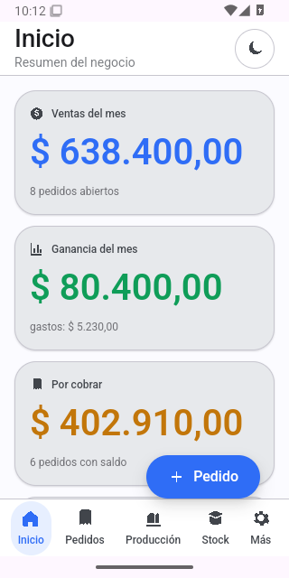

# QA_REPORT.md — Resultados de pruebas (Fase 7)

**Fecha:** 2026-10-27
**Rama:** `main` (merge `7bce770`; fixes `9fde4b8`, `f69a25c`, `21cbd59`)
**Entorno local:** Linux, Node 18.19.1, npm 9.2.0, Rust/cargo 1.99.1, tauri-cli 2.12.4, Tauri 2.12.5
**Android:** JDK Temurin 17.0.21, Android SDK 35/37, build-tools 35.0.0/37.0.0, NDK 27.0.12077973
**WebKitGTK:** 4.1 (desktop)

Este informe distingue **Verificado** (se ejecutó y pasó), **Implementado sin
verificar** (el código existe, pero no se probó de punta a punta) y **No
implementado**.

---

## Criterios ejecutados y resultado

| # | Función / prueba | Resultado | Detalle |
|---|------------------|-----------|---------|
| 1 | `npm run typecheck` | ✅ Verificado | Sin errores de TypeScript. |
| 2 | `npm test` (vitest) | ✅ Verificado | 45 tests: 16 core + 19 version-map + 2 store + 8 latest-json. |
| 3 | `cargo check` desktop Linux | ✅ Verificado | Compila con updater activo; quedan warnings no bloqueantes. |
| 4 | `cargo test` (sync) | ✅ Verificado | 15 tests: identidad, peers, framing y protocolo. |
| 5 | `npm run dev` (Vite) | ✅ Verificado | `http://127.0.0.1:1420/` responde 200. |
| 6 | Navegación por rutas UI | ✅ Verificado (manual) | 16 rutas renderizan sin errores de consola (incluye detalle de pedido/cliente y 404). |
| 7 | Datos de seed | ✅ Verificado | 2 colecciones, 5 productos, 10 pedidos, producción y gastos; stock/reservas/márgenes derivados correctamente. |
| 8 | Material Design 3 y layout adaptativo | ✅ Verificado (manual) | Recorrido visual en navegador 904×675 y en emulador Android 320×640: sidebar/topbar, grillas, tablas, modales, formularios y bottom nav. Sin Playwright que lo automatice. |
| 9 | Tema claro/oscuro | ✅ Verificado (manual) | Ambos temas con contraste legible en navegador y en emulador Android; el cambio de tema se probó desde el topbar. |
| 10 | Persistencia OPFS (`WebEventStore.append`) | ✅ Verificado | 2 tests de regresión; tras recargar, los eventos del seed siguen en disco. Se corrigió el truncado del `.jsonl` en cada append. |
| 11 | Auditoría de clases CSS | ✅ Verificado | ~145 clases relevadas; se restauraron ~40 faltantes. 0 faltantes. |
| 12 | Backend Rust `store_*` (desktop) | ✅ Verificado | Comandos implementados y alineados con el frontend (`store_*`, argumentos planos); `cargo check`/`cargo test` pasan. |
| 13 | `src-tauri/` Android | ✅ Verificado (build) | `tauri android init` regenerado; `libinventario_tienda.so` compila con NDK 27. APK debug arm64: ~268 MB (símbolos), `sha256 edd38e89…c8981f2`, `native-code arm64-v8a`, firmado con debug keystore. APK release arm64: 13 MB, firmado con la keystore release. También se generaron x86_64 debug/release. |
| 14 | Almacenamiento privado Android | ✅ Verificado en emulador | `root_for_app` usa `app_data_dir()`; en Android quedó en `/data/user/0/com.inventariotienda.app/events` (no en `files/`). 13 archivos `.jsonl`, 315 líneas de eventos (313 del seed + 2 `Setting.Set` de tema); tras force-stop, reinstalación `adb install -r` y reapertura siguen 315. |
| 15 | Sincronización P2P (núcleo) | ✅ Verificado | 15 tests Rust. |
| 16 | Sincronización P2P (TLS 1.3 mutuo, mDNS, SAS en vivo, convergencia LAN) | ❌ No implementado | `discovery.rs`/`server.rs` son esqueleto. `ring`/`aws-lc-rs` ya compilan en Android, pero el transporte no está terminado ni probado con dos dispositivos. |
| 17 | Actualizaciones desktop (updater) | ⚠️ Implementado sin verificar | Pubkey y endpoint reales configurados; `cmd_updater_check` usa `UpdaterExt`; UI reacciona. El release dry-run generó AppImage 83.683.832 B + `.sig` 452 B, NSIS 3.622.879 B + `.sig` 448 B y MSI 5.488.640 B + `.sig` 448 B, y un `latest.json` real. **No se probó una actualización real contra un release publicado**: el draft `v1.0.0` todavía no alimenta `releases/latest`. En Android informa que se actualiza reinstalando. |
| 18 | CI/CD (GitHub Actions) | ✅ Verificado | CI [`40484597887`](https://github.com/wulflo/store-inventory/actions/runs/40484597887) en `main`: typecheck, 45 tests, `cargo test` y builds Linux/Windows/Android en verde. Release dry-run [`40484612737`](https://github.com/wulflo/store-inventory/actions/runs/40484612737): `verify`, `build-linux`, `build-windows`, `build-android` y `publish` en verde. `actionlint` pasa. |
| 19 | Android / SAF (carpeta elegible) | ❌ No implementado | Solo almacenamiento privado de la app. No hay selector SAF ni espejo bidireccional. |
| 20 | Build nativo desktop (deb/AppImage/MSI/NSIS) | ✅ Verificado (build y firma en CI) | Release dry-run `40484612737`: AppImage 83.683.832 B, `.deb` 5.231.942 B, MSI 5.488.640 B y NSIS 3.622.879 B, con firmas de updater para AppImage/EXE/MSI. No se ejecutaron los instaladores de escritorio en esta corrida; solo se verificó su construcción y firma. |
| 21 | APK Android debug/release | ✅ Verificado en emulador | APK universal del CI (39.923.555 B, 4 ABIs: arm64-v8a, armeabi-v7a, x86, x86_64) instalado con `adb install -r` y ejecutado en emulador Android 35 (320×640, KVM); arranca, muestra dashboard, navega y conserva 315 eventos. El APK arm64 compila, pero no se ejecutó en hardware real. |
| 22 | Firma Android release | ✅ Verificado (CI + emulador) | Keystore real fuera del repo; `build.gradle.kts` lee `keystore.properties` y firma APK/AAB. APK universal 39.923.555 B y AAB 14.599.467 B, ambos con certificado `CN=Inventario Tienda`, SHA-256 `9fccd9d1…fd492a`; AAB verificado con `jarsigner` y APK con `apksigner`. APK instalado/ejecutado en emulador. |
| 23 | `latest.json` del updater | ✅ Verificado (release dry-run) | `scripts/latest-json.mjs` + 8 tests; generado desde artefactos reales del CI, con firmas que coinciden byte a byte con los `.sig` y URLs que usan los nombres reales con puntos (`Inventario.Tienda…`). Soporta AppImage/`.exe`/`.msi` directos de Tauri v2 y formatos v1; prefiere NSIS. El draft no está publicado: falta probar el updater contra `releases/latest`. |
| 24 | Playwright / E2E automatizado | ❌ No implementado | No instalado; las capturas de `docs/qa/screenshots/` son manuales. |
| 25 | `act` (GitHub Actions local) | ❌ No verificado | No instalado. `actionlint` sí se ejecutó. |

---

## Hallazgos corregidos durante la prueba Android

- **Iconos 16-bit:** los PNG de `src-tauri/icons` tenían 16 bits por canal y
  Tauri los leía mal; el APK hacía panic al iniciar. Se convirtieron a PNG32 de
  8 bits.
- **Contrato de comandos:** Rust registraba `cmd_store_*`/`cmd_sync_*` y esperaba
  `{ args: {...} }`, mientras el frontend invocaba `store_*`/`sync_*` con campos
  planos. Android caía a `MemoryEventStore` y no escribía nada. Se alinearon
  nombres y firmas.
- **Safe area:** la barra de estado tapaba el topbar. Se aplicó el inset nativo
  (`WindowInsetsCompat`) al contenido; CSS no expone la altura de la barra de
  estado en WebView.
- **Bottom nav:** `.layout` medía `100vh` y empujaba la barra inferior fuera de
  pantalla. `#root` ahora es flex column con `100dvh` y `.layout` ocupa el resto.
- **Barra de gestos:** el inset inferior también se aplica de forma nativa para
  que la barra de gestos de Android no tape la bottom nav.

---

## Capturas del APK release en emulador

Datos de demostración, 320×640, Android 35:

| Claro | Oscuro | Menú Más |
|---|---|---|
|  |  |  |

APK universal descargado del release dry-run del CI:

| APK CI instalado en emulador |
|---|
|  |

---

## Limitaciones conocidas

1. **SAF / carpeta elegible:** en Android la app escribe en su almacenamiento
   privado, no en una carpeta elegida por el usuario. No hay espejo SAF.
2. **Transporte P2P:** el núcleo de reconciliación está probado, pero el
   transporte TLS/mDNS sigue sin implementar. No hay prueba de convergencia LAN
   con dos dispositivos.
3. **Updater:** configurado y compilando, pero no se probó una actualización real
   contra un release publicado. El release `v1.0.0` está en **draft** y no
   alimenta `releases/latest`; el endpoint real todavía devuelve 404.
4. **Android en ejecución:** se probó en emulador API 35 x86_64 (320×640, KVM):
   arranque, navegación, tema claro/oscuro y persistencia de 315 eventos,
   incluido el APK universal descargado del CI. **No se probó en un dispositivo
   físico ni el APK arm64**, ni el alta de producto/pedido desde la UI.
5. **Firma Android en CI:** verificada en el release dry-run; el AAB se validó
   con `jarsigner` y el APK con `apksigner`, pero el AAB no se instaló en un
   dispositivo.
6. **Windows:** MSI/NSIS sin certificado Authenticode; SmartScreen puede advertir.
7. **Logo:** no hay archivo de logo definitivo en el repositorio; se usan los
   íconos generados por Tauri.
8. **Release:** el dry-run `40484612737` pasó completo en `main` y creó el draft
   `v1.0.0` con 10 assets. Falta publicarlo (tag público) para que el updater
   pueda resolver `releases/latest`.
9. **P2P en segundo plano:** Android puede suspender la sincronización por Doze;
   solo se plantea en primer plano.
10. **Tamaño del APK debug:** ~268 MB por ABI por los símbolos de depuración; el
    APK release universal pesa 39.923.555 B.
11. **Dependencias:** Dependabot reporta 17 alertas en `main` (3 críticas, 2
    altas, 11 moderadas, 1 baja). `npm audit` local da 6 vulnerabilidades
    dev-only (2 críticas, 1 alta, 3 moderadas) y **0 en producción**
    (`npm audit --omit=dev`).

---

## Qué falta para cerrar la entrega

1. Publicar el draft `v1.0.0` como release público y probar una actualización de
   escritorio de punta a punta contra `releases/latest`.
2. Probar el APK arm64 en un dispositivo físico: alta de producto y pedido,
   cierre de la app y reapertura con datos de usuario.
3. Implementar el transporte P2P real (TLS 1.3 mutuo + mDNS + SAS) y probarlo
   entre dos dispositivos.
4. Implementar SAF para carpeta elegible si se quiere sincronizar por carpeta
   externa en Android.
5. Agregar el logo definitivo y regenerar íconos.
6. Revisar/actualizar las dependencias con alertas de Dependabot.
7. Opcional: Playwright para E2E y capturas.
