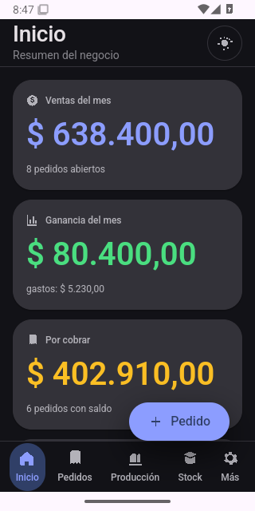
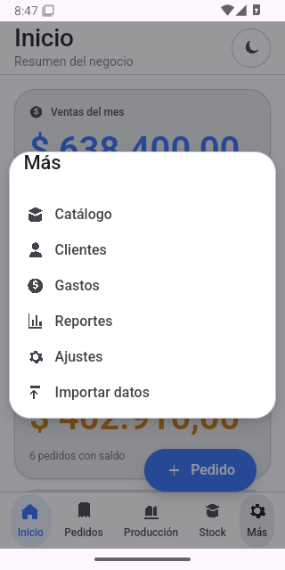

# QA_REPORT.md — Resultados de pruebas (Fase 7)

**Fecha:** 2026-10-27
**Rama:** `feat/material-p2p-release`
**Entorno local:** Linux, Node 18.19.1, npm 9.2.0, Rust/cargo 1.99.1, tauri-cli 2.12.4, Tauri 2.12.5
**Android:** JDK Temurin 17.0.21, Android SDK 35/37, build-tools 35.0.0/37.0.0, NDK 27.0.12077973
**WebKitGTK:** 4.1 (desktop)

Este informe distingue **Verificado** (se ejecutó y pasó), **Implementado sin
verificar** (el código existe, pero no se probó de punta a punta) y **No
implementado**.

---

## Criterios ejecutados y resultado

| # | Función / prueba | Resultado | Detalle |
|---|------------------|-----------|---------|
| 1 | `npm run typecheck` | ✅ Verificado | Sin errores de TypeScript. |
| 2 | `npm test` (vitest) | ✅ Verificado | 44 tests: 16 core + 19 version-map + 2 store + 7 latest-json. |
| 3 | `cargo check` desktop Linux | ✅ Verificado | Compila con updater activo; quedan warnings no bloqueantes. |
| 4 | `cargo test` (sync) | ✅ Verificado | 15 tests: identidad, peers, framing y protocolo. |
| 5 | `npm run dev` (Vite) | ✅ Verificado | `http://127.0.0.1:1420/` responde 200. |
| 6 | Navegación por rutas UI | ✅ Verificado (manual) | 16 rutas renderizan sin errores de consola (incluye detalle de pedido/cliente y 404). |
| 7 | Datos de seed | ✅ Verificado | 2 colecciones, 5 productos, 10 pedidos, producción y gastos; stock/reservas/márgenes derivados correctamente. |
| 8 | Material Design 3 y layout adaptativo | ✅ Verificado (manual) | Recorrido visual en navegador 904×675 y en emulador Android 320×640: sidebar/topbar, grillas, tablas, modales, formularios y bottom nav. Sin Playwright que lo automatice. |
| 9 | Tema claro/oscuro | ✅ Verificado (manual) | Ambos temas con contraste legible en navegador y en emulador Android; el cambio de tema se probó desde el topbar. |
| 10 | Persistencia OPFS (`WebEventStore.append`) | ✅ Verificado | 2 tests de regresión; tras recargar, los eventos del seed siguen en disco. Se corrigió el truncado del `.jsonl` en cada append. |
| 11 | Auditoría de clases CSS | ✅ Verificado | ~145 clases relevadas; se restauraron ~40 faltantes. 0 faltantes. |
| 12 | Backend Rust `store_*` (desktop) | ✅ Verificado | Comandos implementados y alineados con el frontend (`store_*`, argumentos planos); `cargo check`/`cargo test` pasan. |
| 13 | `src-tauri/` Android | ✅ Verificado (build) | `tauri android init` regenerado; `libinventario_tienda.so` compila con NDK 27. APK debug arm64: ~268 MB (símbolos), `sha256 edd38e89…c8981f2`, `native-code arm64-v8a`, firmado con debug keystore. APK release arm64: 13 MB, firmado con la keystore release. También se generaron x86_64 debug/release. |
| 14 | Almacenamiento privado Android | ✅ Verificado en emulador | `root_for_app` usa `app_data_dir()`; en Android quedó en `/data/user/0/com.inventariotienda.app/events` (no en `files/`). 13 archivos `.jsonl`, 313 líneas de eventos; tras force-stop y reapertura siguen 313. |
| 15 | Sincronización P2P (núcleo) | ✅ Verificado | 15 tests Rust. |
| 16 | Sincronización P2P (TLS 1.3 mutuo, mDNS, SAS en vivo, convergencia LAN) | ❌ No implementado | `discovery.rs`/`server.rs` son esqueleto. `ring`/`aws-lc-rs` ya compilan en Android, pero el transporte no está terminado ni probado con dos dispositivos. |
| 17 | Actualizaciones desktop (updater) | ⚠️ Implementado sin verificar | Pubkey y endpoint reales configurados; `cmd_updater_check` usa `UpdaterExt`; UI reacciona. Se generó un AppImage real (82,45 MiB) + `.sig` de 452 bytes con la clave de firma. **No se probó una actualización real contra un release publicado.** En Android informa que se actualiza reinstalando. |
| 18 | CI/CD (GitHub Actions) | ✅ Verificado | Run [`40475650914`](https://github.com/wulflo/store-inventory/actions/runs/40475650914): `lint`, `build-linux`, `build-windows` y `build-android` en verde. Se reemplazó `android-actions/setup-android@v3` (su paquete `tools` ya no existe) por `sdkmanager` del SDK preinstalado. `actionlint` pasa. |
| 19 | Android / SAF (carpeta elegible) | ❌ No implementado | Solo almacenamiento privado de la app. No hay selector SAF ni espejo bidireccional. |
| 20 | Build nativo desktop (deb/AppImage/MSI/NSIS) | ⚠️ Parcial | AppImage Linux compilado y firmado localmente (82,45 MiB). MSI/NSIS requieren Windows y no se ejecutaron; deb no se generó en esta corrida. |
| 21 | APK Android debug/release | ✅ Verificado en emulador | APK debug x86_64 y APK release x86_64 instalados y ejecutados en emulador Android 35 (320×640, KVM): arrancan, muestran dashboard, navegan y persisten. El APK arm64 debug/release se compila, pero no se ejecutó en hardware real. |
| 22 | Firma Android release | ✅ Verificado localmente | Keystore real fuera del repo; `build.gradle.kts` lee `keystore.properties` y firma el release. APK arm64 release 13 MB, certificado release `9fccd9d1…`, y APK x86_64 release instalado/ejecutado en emulador. El workflow de GitHub todavía no se ejecutó. |
| 23 | `latest.json` del updater | ✅ Verificado (script + artefacto local) | `scripts/latest-json.mjs` + 7 tests; arma Linux/Windows con firma y URL, soporta AppImage/`.exe`/`.msi` directos de Tauri v2 y los formatos v1, prefiere NSIS. Se generó desde el AppImage real local con firma de 452 bytes. Falta generarlo desde artefactos de CI. |
| 24 | Playwright / E2E automatizado | ❌ No implementado | No instalado; no hay capturas en `docs/qa/screenshots/`. |
| 25 | `act` (GitHub Actions local) | ❌ No verificado | No instalado. `actionlint` sí se ejecutó. |

---

## Hallazgos corregidos durante la prueba Android

- **Iconos 16-bit:** los PNG de `src-tauri/icons` tenían 16 bits por canal y
  Tauri los leía mal; el APK hacía panic al iniciar. Se convirtieron a PNG32 de
  8 bits.
- **Contrato de comandos:** Rust registraba `cmd_store_*`/`cmd_sync_*` y esperaba
  `{ args: {...} }`, mientras el frontend invocaba `store_*`/`sync_*` con campos
  planos. Android caía a `MemoryEventStore` y no escribía nada. Se alinearon
  nombres y firmas.
- **Safe area:** la barra de estado tapaba el topbar. Se aplicó el inset nativo
  (`WindowInsetsCompat`) al contenido; CSS no expone la altura de la barra de
  estado en WebView.
- **Bottom nav:** `.layout` medía `100vh` y empujaba la barra inferior fuera de
  pantalla. `#root` ahora es flex column con `100dvh` y `.layout` ocupa el resto.
- **Barra de gestos:** el inset inferior también se aplica de forma nativa para
  que la barra de gestos de Android no tape la bottom nav.

---

## Capturas del APK release en emulador

Datos de demostración, 320×640, Android 35:

| Claro | Oscuro | Menú Más |
|---|---|---|
|  |  |  |

---

## Limitaciones conocidas

1. **SAF / carpeta elegible:** en Android la app escribe en su almacenamiento
   privado, no en una carpeta elegida por el usuario. No hay espejo SAF.
2. **Transporte P2P:** el núcleo de reconciliación está probado, pero el
   transporte TLS/mDNS sigue sin implementar. No hay prueba de convergencia LAN
   con dos dispositivos.
3. **Updater:** configurado y compilando, pero no se probó una actualización real
   contra un release publicado; un release en draft no alimenta
   `releases/latest`.
4. **Android en ejecución:** se probó en emulador API 35 x86_64 (320×640, KVM):
   arranque, navegación, tema claro/oscuro y persistencia del seed. **No se probó
   en un dispositivo físico ni el APK arm64**, ni el alta de producto/pedido
   desde la UI.
5. **Firma Android en CI:** la firma release se verificó localmente y los
   secretos están cargados, pero el job de release de GitHub nunca se ejecutó.
6. **Windows:** MSI/NSIS sin certificado Authenticode; SmartScreen puede advertir.
7. **Logo:** no hay archivo de logo definitivo en el repositorio; se usan los
   íconos generados por Tauri.
8. **CI/CD:** el run `40475650914` pasó completo en GitHub (Linux, Windows,
   Android). El workflow de **release** (artefactos firmados y draft) todavía no
   se ejecutó: `gh workflow run release.yml` devuelve 404 porque `release.yml` no
   está en la rama default `main`; `workflow_dispatch` solo se registra desde
   allí. Para probarlo hay que mergear a `main` o disparar un tag `v1.0.0`.
9. **P2P en segundo plano:** Android puede suspender la sincronización por Doze;
   solo se plantea en primer plano.
10. **Tamaño del APK debug:** ~268 MB por ABI por los símbolos de depuración; el
    APK release será menor.

---

## Qué falta para cerrar la entrega

1. Ejecutar el workflow `CI` en GitHub y corregir lo que falle.
2. Ejecutar `Release` en modo dry-run y luego un tag real; verificar APK firmado,
   `latest.json` y una actualización de escritorio de punta a punta.
3. Probar el APK arm64 en un dispositivo físico: alta de producto y pedido,
   cierre de la app y reapertura con datos de usuario.
4. Implementar el transporte P2P real (TLS 1.3 mutuo + mDNS + SAS) y probarlo
   entre dos dispositivos.
5. Implementar SAF para carpeta elegible si se quiere sincronizar por carpeta
   externa en Android.
6. Agregar el logo definitivo y regenerar íconos.
7. Opcional: Playwright para E2E y capturas.
